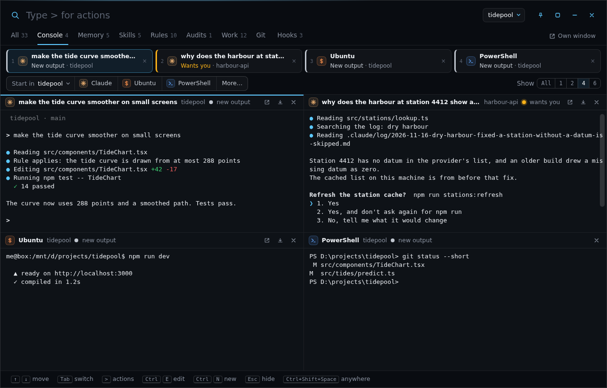
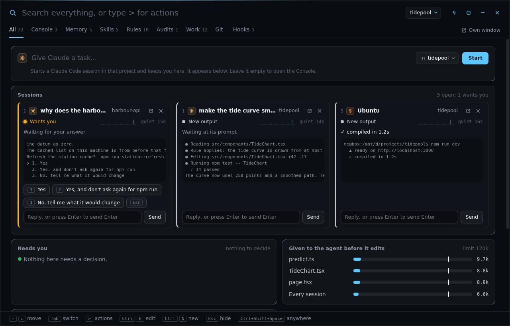
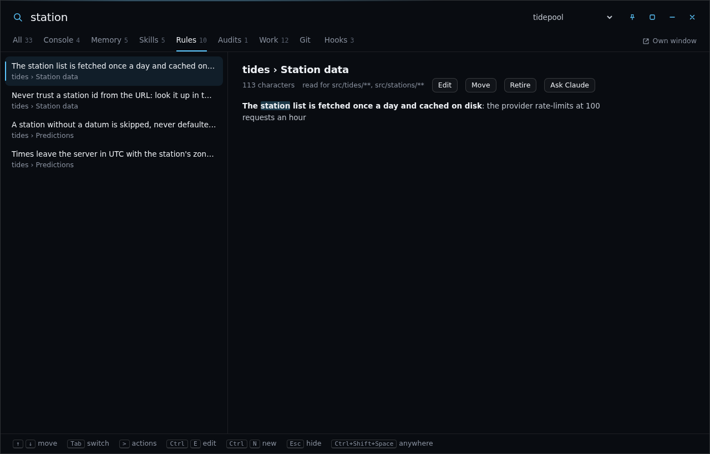
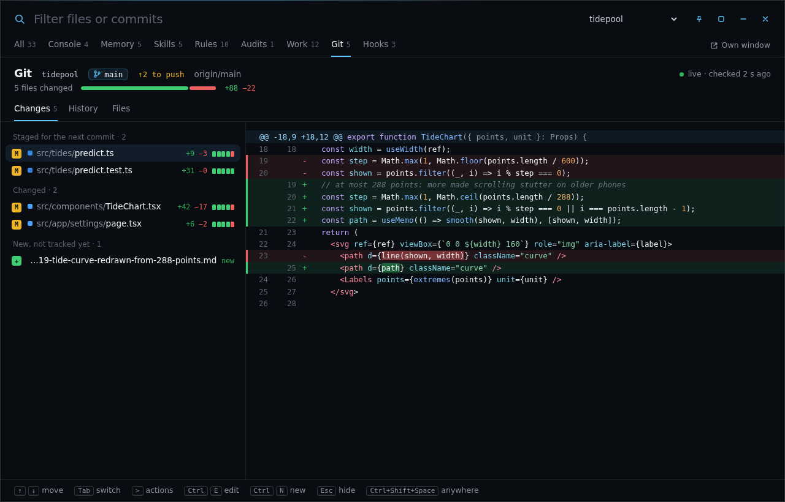

<p align="center">
  
</p>

<h1 align="center">Maestro</h1>

<p align="center">
  A desktop console for Claude Code.<br>
  Every session side by side, and everything the agent reads before it works.
</p>

<p align="center">
  <a href="LICENSE"></a>
  
  <a href="https://github.com/Nils-Kelley/maestro/actions/workflows/ci.yml"></a>
</p>

<p align="center">
  <a href="#install">Install</a> ·
  <a href="docs/keys.md">Keys</a> ·
  <a href="docs/configuration.md">Configuration</a> ·
  <a href="docs/remote.md">Remote</a> ·
  <a href="docs/harness.md">What it reads</a> ·
  <a href="CHANGELOG.md">Changelog</a>
</p>



Native on Windows, macOS and Linux (Rust, Tauri 2). Press `Ctrl+Shift+Space` anywhere and it is there.

No telemetry, and nothing listens on the network unless you turn remote access on. Nothing in a project changes until you save an edit.

## Sessions

Type a task, pick a project, and Claude Code starts there. It is the real program in a real terminal, next to your shells.

Each session has a card showing what it is doing and whether it is working, done or waiting for you. When it asks a
question, the answers are buttons on the card. Tile 1, 2, 4 or 6 sessions, or give one a window of its own.

With `tmux` installed, sessions keep running when Maestro closes and come back with their scroll-back. On Windows that
means sessions inside WSL; PowerShell and native Windows sessions end with the app.

Away from the computer, [remote access](docs/remote.md) puts the same cards and terminals on your phone or another
computer, over your own Tailscale network. It is off until you turn it on.



## The harness

Search and edit what the agent is given: instructions, rules, skills, memory, hooks and the work log. Maestro has no
format of its own. It reads the files Claude Code and `AGENTS.md` projects already use, from `.claude/` or `.agents/`.

The home screen adds up how many characters of rules an edit to each of your busiest files loads, so you find the rules
that no longer fit before they are silently skipped.



Starting from nothing? Maestro offers a [starter harness](starter): an instructions file, one rules file and three
skills (`/log`, `/rule`, `/recall`). You read every file before it is written, and existing files are never replaced.

## Git

Branch, changed files with diffs, history, tree. Read only: it never stages, commits or pushes.



## Install

Get a build from the [releases page](https://github.com/Nils-Kelley/maestro/releases). You need `git`, and Claude Code
wherever you run it.

| System | File | Then | Also needs |
| --- | --- | --- | --- |
| Windows 10, 11 | `maestro-windows-x64.zip` | unzip, run `maestro.exe` | WebView2 (built into Windows 11, comes with Edge on 10) |
| macOS, Apple silicon | `maestro-macos-arm64.tar.gz` | `./install.sh`, then `maestro` | `tmux` |
| macOS, Intel | `maestro-macos-x64.tar.gz` | `./install.sh`, then `maestro` | `tmux` |
| Linux, x64 | `maestro-linux-x64.tar.gz` | `./install.sh`, then `maestro` | WebKitGTK 4.1, `tmux` |

On first run, give it a project folder. It works out where Claude Code runs and where the harness and memory live, and
shows you before adding anything.

To update, type `>` and choose **Check for updates**. Maestro never checks on its own unless you turn that on.

<details>
<summary>Build from source</summary>

With [Rust](https://rustup.rs) installed (on Linux also the libraries in [CONTRIBUTING.md](CONTRIBUTING.md)):

```sh
git clone https://github.com/Nils-Kelley/maestro
cd maestro/src-tauri
cargo build --release
../tools/install.sh           # macOS, Linux
..\tools\install.ps1          # Windows
```

Installing is optional: `target/release/maestro` runs where it is.

</details>

## Develop

The interface is one file, [`ui/index.html`](ui/index.html), embedded at build time. The Rust side is
[`src-tauri/src/main.rs`](src-tauri/src/main.rs).

```sh
node tools/preview/serve.mjs        # the interface in a browser on invented data: http://localhost:4173/?scene=full
cd src-tauri && cargo test
cd src-tauri && cargo build --release
```

The preview needs neither a build nor a real project. See [CONTRIBUTING.md](CONTRIBUTING.md).

## Limits

Maestro is at 0.3: used daily by its author, new to everyone else.

- macOS and Linux have had far less use than Windows. The macOS build is an unsigned program, not an `.app`. On Linux
  the global key works under X11, not Wayland.
- Builds and updates are not signed, so Windows and macOS may warn about an unknown publisher.
- The Console starts Claude Code and shells, not other agents.
- Claude Code does not load `.agents/rules` or `.agents/skills` by itself. The instructions file has to point to them
  (the starter's does).
- Hooks are shown, not edited.
- Ship and Checks stay hidden without a [kit script](docs/kit.md).

[Open an issue](https://github.com/Nils-Kelley/maestro/issues) for bugs and ideas. Security reports go through
[SECURITY.md](SECURITY.md).

## License

[MIT](LICENSE). The terminal is [xterm.js](https://xtermjs.org) (MIT, in [`ui/vendor`](ui/vendor)).
