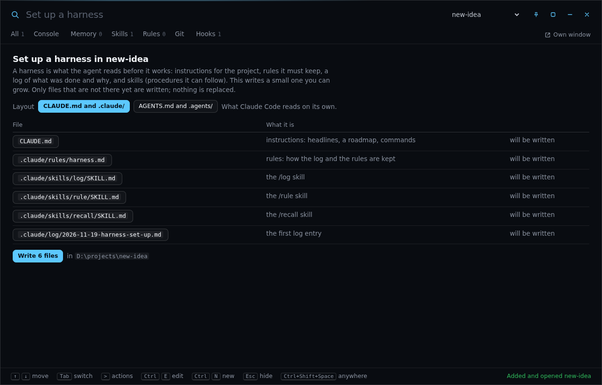

<p align="center">
  
</p>

<h1 align="center">Maestro</h1>

<p align="center">
  A desktop console for Claude Code: every session side by side, and everything the agent is given before it works.
</p>

<p align="center">
  <a href="LICENSE"></a>
  
  <a href="https://github.com/Nils-Kelley/maestro/actions/workflows/ci.yml"></a>
</p>


Maestro is a native Windows app (Rust and Tauri 2) with one job: keep you oriented when several agents are working for you.
Press **Ctrl+Shift+Space** anywhere and it is there.

- **Sessions.** Run the real Claude Code in as many projects as you like, next to plain terminals. Each tab says whether its
  session is working, finished, waiting for you or idle. Sessions that run inside WSL keep running when Maestro closes and are
  back, scroll-back included, when it opens.
- **The harness.** Search and edit what the agent reads: instructions, rules, skills, memory, hooks and the work log. See how
  many characters of rules an edit to a given file loads, before the agent hits the limit.
- **Git, read only.** The branch, every changed file with its diff, the history, the tree. It never stages, commits or pushes.

There is no server and no port. The interface talks to the Rust side over the window's own IPC, the app makes no network
requests, and nothing in a project changes until you save an edit.

## Contents

- [Install](#install)
- [First run](#first-run)
- [It reads the harness you already have](#it-reads-the-harness-you-already-have)
- [No harness yet: the starter](#no-harness-yet-the-starter)
- [Sessions](#sessions)
- [Keys](#keys)
- [Configuration](#configuration)
- [What Maestro writes](#what-maestro-writes)
- [Develop](#develop)
- [Status and limits](#status-and-limits)

## Install

**Requirements:** Windows 10 or 11 with the WebView2 runtime (part of Windows 11; on Windows 10 it comes with Edge), Git for
Windows for the Git tab, and Claude Code installed where you run it: inside WSL, on Windows, or both.

**From a release.** Download `maestro-windows-x64.zip` from the
[releases page](https://github.com/Nils-Kelley/maestro/releases), unzip it anywhere and run `maestro.exe`.

**From source.** With [Rust](https://rustup.rs) installed:

```powershell
git clone https://github.com/Nils-Kelley/maestro
cd maestro\src-tauri
cargo build --release
..\tools\install.ps1      # copies it to %LOCALAPPDATA%\Programs\Maestro and adds a Start Menu entry
```

The first build takes a few minutes. `install.ps1` is optional: `target\release\maestro.exe` runs where it is.

## First run

Maestro opens on a welcome screen and asks for one thing, a project folder. Type it or browse to it, the Windows way
(`D:\projects\my-site`) or the WSL way (`/mnt/d/projects/my-site`, `/home/me/my-site`). It works out the rest and shows what it
found before anything is added:

- whether Claude Code runs **inside WSL** or **on Windows** for that folder (it looks at which side has worked there before;
  you can switch it),
- where the harness is kept (`.claude/` or `.agents/`),
- where Claude keeps that project's memory.

Add as many projects as you like; star the ones you use most.

## It reads the harness you already have

Maestro has no format of its own. It reads the files Claude Code and the `AGENTS.md` convention already use, and shows a tab
only when the project has something for it.

| Tab | What it shows | Read from |
| --- | --- | --- |
| Memory | Each memory as a page; search, edit, add | Claude's memory folder for the project (`~/.claude/projects/<project>/memory/`) |
| Skills | Your skills and the project's; edit, add | `~/.claude/skills/`, `<harness>/skills/*/SKILL.md` |
| Rules | Every rule as a searchable line; edit, move between files, retire | `<harness>/rules/*.md` |
| Hooks | What runs when, and who set it | `settings.json`, yours and the project's |
| Work | The log of what was done and why | `<harness>/log/YYYY-MM-DD-*.md` |
| Audits | Review documents | files with "audit" in the name under `docs/`, `.planning/`, `<harness>/reference/` |
| Git | Changes, history, tree | the project's repository |
| Console | Sessions | see [Sessions](#sessions) |

`<harness>` is `.claude/`, or `.agents/` in a project that keeps its rules, skills or log there. The instructions file is
`CLAUDE.md`, or `AGENTS.md` where that is the one the project has. [docs/harness.md](docs/harness.md) has the exact shapes.


The home screen answers one question first: does anything need you? It then shows how much the agent is handed before it
edits each of your busiest files (name them as `hot` in `<harness>/maestro.json`), so rules that grew past what fits are found
before they are silently skipped.


## No harness yet: the starter

Point Maestro at a project with nothing in it and it offers a small harness you can grow, in either layout:



- an instructions file (`CLAUDE.md` or `AGENTS.md`): what the project is, headlines of recent work, a roadmap, commands;
- `rules/harness.md`: how the log and the rules are kept, and how claims are evidenced (ran, read, not run);
- three skills: `/log` records a finished piece of work as one dated entry and a headline, `/rule` adds one rule to the right
  file, `/recall` answers "why is this like that" from the log before anything is re-derived;
- a first log entry.

You see every file before it is written. Only files that are missing are written; nothing is ever replaced. The templates are
plain Markdown in [`starter/`](starter): read them, change them, send a pull request.

With the `AGENTS.md` layout Maestro also writes a one-line `CLAUDE.md` (`@AGENTS.md`) so that Claude Code picks the
instructions up.

## Sessions

Start one from the Console tab: Claude Code with a first message, continue the last conversation, resume an earlier one, or
open a shell. Every session is the real program in a real terminal; Maestro adds nothing between you and it.

| The project's agent runs | Claude Code | Shells | When Maestro closes |
| --- | --- | --- | --- |
| inside WSL | in a tmux server of its own in the distro | Ubuntu, PowerShell | Claude and Ubuntu sessions keep running and are reopened; PowerShell ends |
| on Windows | started directly | PowerShell | sessions end |

For WSL projects install `tmux` in the distro (`sudo apt install tmux`); without it sessions still open but end with the app.
Maestro's tmux server (`tmux -L maestro`) is separate from any tmux you use yourself. See [wsl/README.md](wsl/README.md).

Views: **All** shows a card per session with what was asked, what it is doing now and its last lines; **1, 2, 4, 6** tile that
many side by side. Any session, and any tab of the app, can be given a window of its own.


## Keys

| Key | Does |
| --- | --- |
| `Ctrl+Shift+Space` | Show or hide Maestro, from anywhere |
| type | Search memories, skills, rules, audits and the log at once |
| `>` | Actions: new session, new memory, switch project, set up a harness, quit |
| `Tab` / `Shift+Tab` | Next / previous tab |
| `↑` `↓` | Move in a list |
| `Ctrl+E` / `Ctrl+S` | Edit the selected memory, skill or rule / save |
| `Ctrl+N` | New memory (new skill on the Skills tab) |
| `Ctrl+R` | Read the files again |
| `Esc` | Step back; on the home screen, hide |
| `Ctrl+Q` | Quit |

In the Console:

| Key | Does |
| --- | --- |
| `Ctrl+Shift+N` / `U` / `P` | New Claude Code, Ubuntu, PowerShell session |
| `Alt+1`…`9`, `Ctrl+Tab` | Switch session |
| `Ctrl+Shift+A` / `L` | All sessions at a glance / cycle the tiles |
| `Ctrl+Shift+O` | The session in a window of its own |
| `Ctrl+Shift+K` | More ways to start |
| `Ctrl+Shift+C` / `V` | Copy / paste (highlighting also copies) |

Every other key goes to the session.

## Configuration

Maestro keeps one file, `maestro.config.json`, beside the program (or in `%APPDATA%\Maestro` when that folder cannot be
written). The app writes it; you rarely edit it by hand. [`maestro.config.example.json`](maestro.config.example.json) shows the
shape.

| Field | Meaning |
| --- | --- |
| `hotkey` | The key that shows and hides the window, for example `Ctrl+Shift+Space` or `Alt+Space`. Read at start. |
| `projects[].name`, `root` | The name shown and the folder, as Windows opens it |
| `projects[].runs` | `wsl` or `windows`: where this project's agent runs |
| `projects[].wslRoot`, `distro` | The folder as WSL sees it, and the distro (WSL projects) |
| `projects[].claudeHome`, `memoryDir` | Claude's own folder and the project's memory folder |
| `projects[].favorite` | Listed first, with one-click start buttons |
| `projects[].audits` | Extra folders whose `.md` and `.txt` files appear under Audits |
| `projects[].kit` | Optional: a script that answers the Ship and Checks screens ([docs/kit.md](docs/kit.md)) |

Per project, `<harness>/maestro.json` may hold `{ "hot": ["src/a.ts", …], "limit": 120000 }`: the files whose rule load the
home screen measures and the number of characters it is held against.

## What Maestro writes

Nothing leaves your machine: the app has no network code and no telemetry. On disk it writes only this:

- `maestro.config.json` and `maestro.log` (interface errors), beside the program.
- A memory, skill or rule **when you save an edit**. The first copy of a changed file each day is kept in
  `<harness>/archive/` (skills: `~/.claude/backups/`). A retired rule is kept in `<harness>/archive/retired-laws.md`.
- The starter harness, when you ask for it: missing files only.
- `term.sh` and `tmux.conf` in `~/.local/share/maestro/` inside a WSL distro, the first time a session is opened there.
- `Start with Windows`, when you tick it: one value under the current user's `Run` registry key.

The first thing asked in a session is shown in lists; anything that looks like a pasted login is cut from that line before it
is displayed.

## Develop

The whole interface is one file, [`ui/index.html`](ui/index.html), embedded into the program at build time; the Rust side is
[`src-tauri/src/main.rs`](src-tauri/src/main.rs).

```bash
node tools/preview/serve.mjs        # the interface in a browser, on invented data: http://localhost:4173/?scene=full
cd src-tauri && cargo test          # the Rust tests
cd src-tauri && cargo build --release
```

The preview stands in for the Rust side with a made-up project, so interface work needs neither a build nor a real project
(scenes: `full`, `bare`, `welcome`). The screenshots in this README were taken from it. From WSL, `tools/build.sh` checks the
page's script and builds with the Windows toolchain; `tools/build.sh test` runs the tests.

[CONTRIBUTING.md](CONTRIBUTING.md) has the conventions, and how to keep private project names out of a commit.

## Status and limits

Maestro is at 0.1: used daily by its author, new to everyone else. Known limits:

- **Windows only.** Tauri runs on macOS and Linux, but the session layer, the hotkey and the window are written for Windows.
- **Sessions are Claude Code.** The harness screens read `AGENTS.md` projects from any agent; the Console starts Claude Code
  and shells.
- **In an `.agents/` project, Claude Code does not load `.agents/rules` or `.agents/skills` by itself.** Maestro shows and edits them;
  the instructions file has to tell the agent to read them (the starter's does).
- **Hooks are shown, not edited.**
- **Ship and Checks** (a deploy ledger and recorded test passes) need a kit script and stay hidden without one:
  [docs/kit.md](docs/kit.md).

Bugs and ideas: [open an issue](https://github.com/Nils-Kelley/maestro/issues). Security reports: [SECURITY.md](SECURITY.md).

## License

[MIT](LICENSE). The terminal is [xterm.js](https://xtermjs.org) (MIT, in [`ui/vendor`](ui/vendor)).
